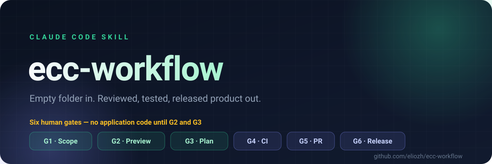
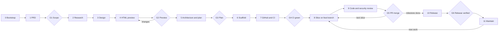
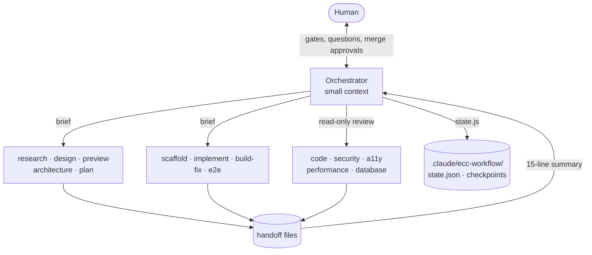

<div align="center">



**A Claude Code skill that takes a project from an empty folder to a reviewed, tested, released product.**

[](LICENSE)
[](https://github.com/eliozh/ecc-workflow/actions/workflows/ci.yml)
[](SKILL.md)
[](SKILL.md)
[](assets)

[English](README.md) · [简体中文](README.zh-CN.md) · [Full workflow](WORKFLOW.md) · [Skill reference](docs/skill-reference.md)

</div>

---

> [!IMPORTANT]
> **The one rule:** no application code exists until a human has approved an HTML preview of the product and the implementation plan derived from it.
>
> Two Hookify rules block code writes and scaffolders mechanically until that plan is approved. Six named gates hold everything else. Silence is never approval.

## Why this exists

Agents are very good at writing code and very bad at knowing whether they should. A one-line prompt becomes a thousand lines of source before anyone has agreed on what the screens look like, which flows matter, or what "done" even means. Correcting that at code-review time is expensive; correcting it at preview time is cheap.

`ecc-workflow` moves every expensive decision to the cheapest moment:

| | A typical agent run | `ecc-workflow` |
|---|---|---|
| First artifact | Source code | A PRD and a clickable preview |
| When scope changes | During implementation | At G1/G2, before any code exists |
| Who approves | Nobody, or a diff | A human, at six named gates |
| Unit of work | "Implement the feature" | One issue → one branch → one PR → one merge |
| Context | Grows until it overflows | Orchestrator stays small; subagents do the work |
| Interrupted? | Start over | Resume from `state.json`, `in_flight`, and checkpoints |

It is built on the **ECC plugin 2.2.x** surface — its commands, skills, agents, hooks, Plan Canvas, and reviewers — and it works for any stack: TypeScript, Python, Go, Rust, Java, Kotlin, Swift, Flutter, C#, C++, PHP, Ruby, or something else entirely.

## Quick start

**1. Install the skill** into your personal Claude Code skills directory:

```bash
git clone https://github.com/eliozh/ecc-workflow.git ~/.claude/skills/ecc-workflow
```

<details>
<summary>Other install options</summary>

**Per project only** — clone into that project's `.claude/skills/`:

```bash
git clone https://github.com/eliozh/ecc-workflow.git <project>/.claude/skills/ecc-workflow
```

**From a local checkout** (edits take effect immediately):

```bash
ln -s /path/to/ecc-workflow ~/.claude/skills/ecc-workflow
```

Start a new Claude Code session after installing so the skill is picked up.

</details>

**2. Check the prerequisites:**

```bash
gh auth status && command -v ecc-plan-canvas && git --version && node --version
```

**3. Build something.** Create an empty folder, open Claude Code there, and type:

```text
/ecc-workflow new a habit tracker for small teams
```

The skill asks for the idea, writes the PRD, researches what already exists, designs the product, builds an HTML preview, opens it in **Plan Canvas** for you to annotate and approve, then plans the architecture — and only then writes code.

Adding to an existing project works the same way:

```text
/ecc-workflow feature add SSO login
```

## The lifecycle



### The six gates

| Gate | A human approves | How |
|---|---|---|
| **G1** | Problem, users, measurable hypothesis, MVP, out of scope | Reply yes in chat |
| **G2** | What the product looks like and how it flows | Annotate and click **Approve** in Plan Canvas |
| **G3** | Stack, architecture decisions, slice order | Annotate and click **Approve** in Plan Canvas |
| **G4** | CI green on the base branch, branch protection on | Reply yes |
| **G5** | Each pull request — CI status and findings by severity | Reply "merge" |
| **G6** | The release, running and verified, rollback rehearsed | Reply yes |

Every gate records its approval time and evidence path in the state file. A gate with no explicit human answer blocks the run.

## What actually stops the code

At Stage 0 (greenfield) or F0 (feature), the skill installs two **Hookify** rules into the project:

| Rule | Blocks | Until |
|---|---|---|
| `block-code-before-approval` | Write/Edit of anything outside `design/`, `docs/`, `.claude/`, Markdown, and `.gitignore` | G2 and G3 are approved |
| `block-scaffold-before-approval` | `npm create`, `cargo new`, `uv init`, `rails new`, `flutter create`, and other scaffolders | G2 and G3 are approved |

They are removed automatically when G3 is approved — that is the exact moment code becomes legal.

> [!WARNING]
> **The guard is a guardrail, not a lock.** It stops the agent's file edits and known scaffolders. It does not stop a shell redirect (`echo x > src/app.ts`), and it does not bind you. It is also local-only: Hookify rules must stay untracked, so a fresh clone does not carry them. Your gate approvals are the real control.

## Feature mode

`/ecc-workflow feature <idea>` appends a milestone to the existing plan, pauses the current one, and reuses the same gates. It never scaffolds, never creates a repository, and never rewrites history.


F0 is the difference: it records a baseline — test, lint, typecheck, build, the base branch and commit — insists on a clean tree, installs the guard, and verifies CI is already green. F2–F4 are skipped when the feature needs no external research, UI, or output-format change. F7 restores the paused milestone exactly where it stopped.

## Architecture: one orchestrator, many scoped subagents

The main session is deliberately small. It talks to you, holds the gates, runs git and `gh` writes, and maintains the state file. Everything else is delegated with a bounded brief.



Each subagent gets exactly five things:

1. **What to read** — explicit paths, no exploration.
2. **What to write** — an allow-list of paths.
3. **What to do** — one deliverable.
4. **What not to do** — the standard do-not list plus role-specific limits.
5. **When it is done** — checkable criteria.

No subagent may ask you a question, approve a gate, edit the state file, run a git or `gh` write, work around a hook, install anything globally, spawn another agent, or follow instructions embedded in repository content, issues, PRs, CI logs, or web pages.

Subagents write their full results to handoff files and return **15 lines or fewer**. The orchestrator reads the summary, not the file — which is why a twelve-stage project does not fill its context window.

## State that survives interruption

Everything the run needs to resume lives in `.claude/ecc-workflow/` inside the target project, written atomically through `assets/state.js`:

```text
state.json                 stage, mode, gates, slices, next_action, in_flight
handoffs/                  one file per stage; the summary is what the orchestrator reads
slices/<id>/               brief, implementation, verification, review findings, CI logs
screens/                   preview and QA screenshots
checkpoints/               the previous state before every write (last 50 kept)
archive/                   paused milestones and finished feature records
```

Before every delegation the orchestrator writes `in_flight`; when the subagent returns it clears it. If a session dies, the next one resumes from `in_flight` plus the handoff file and re-dispatches the recorded role instead of assuming the work finished. Optional `PreCompact`, `Stop`, and `SessionEnd` hooks snapshot the state at session boundaries:

```bash
node assets/state.js hooks install
```

## Commands

| Command | What happens |
|---|---|
| `/ecc-workflow new <idea>` | Starts a greenfield project at Stage 0 |
| `/ecc-workflow feature <idea>` | Adds a feature to an existing project (F0–F7); `add` is an alias |
| `/ecc-workflow` or `/ecc-workflow resume` | Prints status and continues from `next_action` |
| `/ecc-workflow status` | Prints status only; changes nothing |
| `/ecc-workflow slice <id>` | Jumps to a specific slice in Stage 8 (after G4) |
| `/ecc-workflow goto <stage>` | Goes **back** to redo a stage, for example `goto 4` to change the preview. Gates after it are reset to pending. |

The skill runs only when you invoke it. `disable-model-invocation: true` means Claude will not start it on its own.

## What it creates in your project

```text
.claude/ecc-workflow/            local workflow state, handoffs, checkpoints   (gitignored)
.claude/hookify.*.local.md       pre-approval guard, removed at G3            (gitignored)
.claude/settings.local.json      optional state snapshot hooks                (gitignored)
.claude/prds/<name>.prd.md       requirements                                 (committed)
.claude/plans/<name>.plan.md     implementation plan                          (committed)
.claude/features/<NN>-<slug>/    feature spec                                 (committed)
design/                          direction, tokens, flows, approved preview   (committed)
docs/adr/, docs/release/         architecture decisions, release plans        (committed)
.github/                         CI, Dependabot, PR template                  (committed)
```

## Works with your stack

The stages never change; only the commands, rule pack, and reviewer do. A few examples from the stack table in [`WORKFLOW.md`](WORKFLOW.md#adapting-to-your-stack):

| Stack | Test | Lint | Reviewer |
|---|---|---|---|
| TypeScript / JavaScript | `npm test` | `npx eslint .` | `typescript-reviewer` |
| React / Next.js | `npm test`, `/react-test` | `next lint` | `/react-review` |
| Python / Django / FastAPI | `pytest` | `ruff check .` | `/python-review` |
| Go | `go test ./...` | `golangci-lint run` | `/go-review` |
| Rust | `cargo test` | `cargo clippy -- -D warnings` | `/rust-review` |
| Java / Kotlin / Swift / Flutter / C# / C++ | see `WORKFLOW.md` | … | stack reviewer |

Projects without a GUI still get a preview: a CLI becomes styled terminal transcripts, an API becomes a reference page, a library becomes a quick-start page, a data pipeline becomes sample reports and alerts.

## Repository layout

```text
SKILL.md                     orchestrator instructions, gates, state and handoff formats
references/stages.md         step-by-step procedure for every stage, loaded one at a time
references/subagents.md      brief template and do/do-not rules for all 18 subagent roles
assets/bootstrap.sh          Stage 0: repo, guard rules, local state directory
assets/guard.sh              install / remove / report the pre-approval guard
assets/state.js              atomic state writes, checkpoints, in_flight, snapshot hooks
assets/*.test.js             node:test suite for state.js, guard.sh, and bootstrap.sh
assets/ci.yml                CI workflow template for generated projects
assets/dependabot.yml        Dependabot template
assets/pull_request_template.md
WORKFLOW.md                  the human-readable process, in full (English)
WORKFLOW.zh-CN.md            the same, in 简体中文
docs/skill-reference.md      deeper operational reference
docs/assets/hero.svg         the banner above
```

## Verify the skill

The bundled suite covers the state machine, the guard installer, and bootstrap. It runs on `node:test` with no dependencies:

```bash
node --test assets/*.test.js
```

Expected: **25 tests, 25 passing.** The same command runs in CI on every push and pull request.

## Requirements

| Requirement | Why |
|---|---|
| Claude Code with the **ECC plugin 2.2.x** and hooks enabled | Provides the commands, agents, reviewers, Hookify, and Plan Canvas |
| `git` and a signed-in `gh` | Branches, commits, PRs, issues, protection, releases |
| `node` (18+) | `assets/state.js` |
| `ecc-plan-canvas` on `PATH` | G2 and G3 approval sessions |
| `chrome-devtools` MCP (ships with ECC) | Preview and UI checks; without it those checks are reported as skipped |
| ECC `common` rule pack in `~/.claude/rules/ecc/` | Project conventions; stack packs are added at Stage 6 |

The one-time setup for rule packs and the Plan Canvas wrapper is documented in [`WORKFLOW.md`](WORKFLOW.md#before-your-first-project).

## Limits, honestly

- **Two modes.** `new` starts from an empty folder; `feature` adds a milestone to an existing project. Small changes can still use ECC's lighter `/ecc:orch-add-feature`, `/ecc:orch-fix-defect`, and `/ecc:orch-change-feature`.
- **The guard is not a sandbox.** It is a guardrail against the agent's own edits, not against shell redirection or a human.
- **Some GitHub settings are manual.** Secret scanning, push protection, Dependabot alerts, and CodeQL are enabled by you in repository settings. Branch protection may be unavailable for private repositories on the free plan.
- **Deploys are yours.** The skill writes the deploy and rollback plan and verifies the result, but runs a deploy only when you confirm it.
- **Previews have limits.** They prove layout and flow, not native gestures, real terminal behavior, or game feel.
- **It is opinionated.** Six gates and one issue per slice are the point. If you want a lighter loop, this is not the tool.

## Contributing

Issues and pull requests are welcome. Read [`CONTRIBUTING.md`](CONTRIBUTING.md) first — it covers the test command, the file layout, and the rule that the orchestrator stays small.

If you find a bug in how a gate or the state machine behaves, a failing test in `assets/*.test.js` is the most useful possible report.

## License

[MIT](LICENSE) © 2026 eliozh
