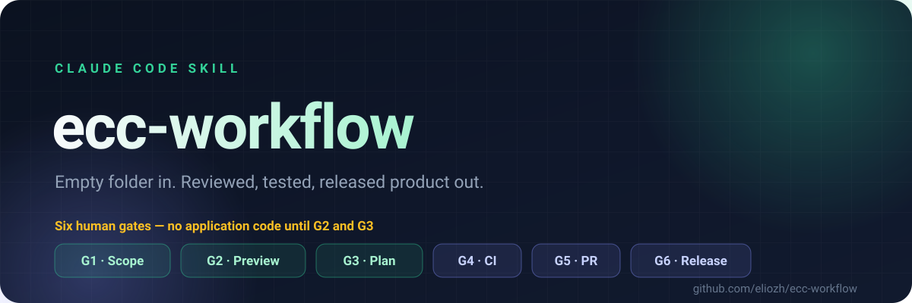
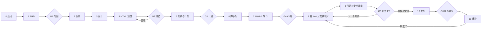
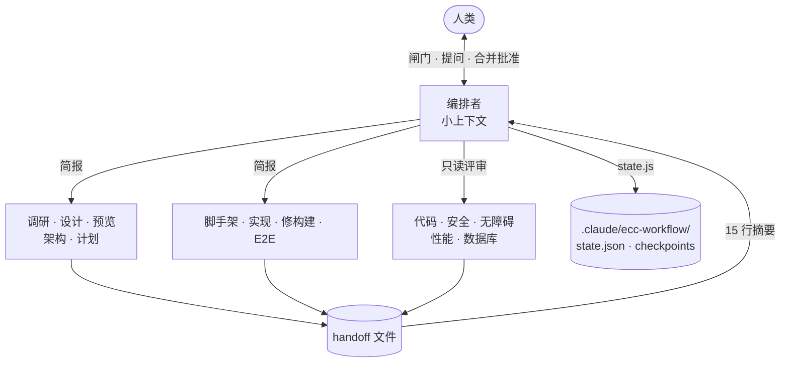

<div align="center">



**一个 Claude Code 技能：从空文件夹，到一个经过评审、测试并发布的产品。**

[](LICENSE)
[](https://github.com/eliozh/ecc-workflow/actions/workflows/ci.yml)
[](SKILL.md)
[](SKILL.md)
[](assets)

[English](README.md) · [简体中文](README.zh-CN.md) · [完整流程](WORKFLOW.zh-CN.md) · [技能参考](docs/skill-reference.md)

</div>

---

> [!IMPORTANT]
> **唯一铁律：** 在人类批准产品的 HTML 预览稿、以及基于该预览稿的实现计划之前，**不写任何应用代码**。
>
> 两条 pre-approval Hookify 规则会在计划获批前机械地拦截代码写入和脚手架命令；第三条把工作流状态与本地设置绑定到各自的 helper。此外还有六道人工闸门。沉默永远不等于批准。

## 为什么需要它

Agent 非常擅长写代码，却完全不知道此刻该不该写。一句提示词，就能在你还没确认页面长什么样、哪些流程重要、什么叫“完成”之前，产出上千行源码。在代码评审阶段纠正这些错误很贵；在预览稿阶段纠正却很便宜。

`ecc-workflow` 把每一个昂贵决策，挪到它最便宜的时刻：

| | 普通的 Agent 流程 | `ecc-workflow` |
|---|---|---|
| 第一个产物 | 源代码 | 一份 PRD 和一个可点击的预览稿 |
| 需求变更发生在 | 实现中途 | G1 / G2，代码还不存在的时候 |
| 谁批准 | 没人，或只看一个 diff | 人类，在六道有名字的闸门 |
| 工作单元 | “把这个功能做了” | 一个 issue → 一个分支 → 一个 PR → 一次合并 |
| 上下文 | 一路膨胀到溢出 | 编排者保持精简，脏活交给子代理 |
| 中断之后 | 从头再来 | 从 `state.json`、`in_flight` 和 checkpoint 恢复 |

它构建在 **ECC 插件 2.2.x** 的能力之上——命令、技能、代理、钩子、Plan Canvas 和评审器——并且适用于任何技术栈：TypeScript、Python、Go、Rust、Java、Kotlin、Swift、Flutter、C#、C++、PHP、Ruby，或者别的什么。

## 快速开始

**1. 安装技能** 到个人 Claude Code 技能目录：

```bash
git clone https://github.com/eliozh/ecc-workflow.git ~/.claude/skills/ecc-workflow
```

<details>
<summary>其他安装方式</summary>

**只给单个项目用**——克隆到该项目的 `.claude/skills/`：

```bash
git clone https://github.com/eliozh/ecc-workflow.git <project>/.claude/skills/ecc-workflow
```

**从本地仓库链接**（改完立即生效）：

```bash
ln -s /path/to/ecc-workflow ~/.claude/skills/ecc-workflow
```

安装后请新开一个 Claude Code 会话，让技能被加载。

</details>

**2. 检查前置条件：**

```bash
gh auth status && command -v ecc-plan-canvas && git --version && node --version
```

**3. 开始构建。** 新建一个空文件夹，在里面打开 Claude Code，然后输入：

```text
/ecc-workflow new 一个给小型团队用的习惯打卡应用
```

技能会向你提问，写 PRD，调研已有方案，做产品设计，构建 HTML 预览稿，在 **Plan Canvas** 里打开让你逐处标注并批准，然后规划架构——**之后**才开始写代码。

给已有项目加功能也是同一条路：

```text
/ecc-workflow feature 增加 SSO 登录
```

## 生命周期



### 六道闸门

| 闸门 | 人类批准什么 | 怎么批准 |
|---|---|---|
| **G1** | 问题、用户、可度量假设、MVP、不做什么 | 在对话里回复 yes |
| **G2** | 产品长什么样、怎么走通 | 在 Plan Canvas 里标注并点击 **Approve** |
| **G3** | 技术栈、架构决策、切片顺序 | 在 Plan Canvas 里标注并点击 **Approve** |
| **G4** | 基线分支 CI 绿、分支保护已开 | 回复 yes |
| **G5** | 每个 PR——CI 状态与按严重度分级的发现 | 回复 “merge” |
| **G6** | 发布已运行并验证，回滚已演练 | 回复 yes |

每次批准都会把时间与证据路径写入状态文件。没有明确的人工答复，流程就停在那里。

## 到底是什么在拦住代码

在 Stage 0（新建）或 F0（功能模式）时，技能会向项目安装两条 pre-approval **Hookify** 规则和一条 state-writer 规则：

| 规则 | 拦截 | 解除于 |
|---|---|---|
| `block-code-before-approval` | 对 `design/`、`docs/`、`.claude/`、Markdown 和 `.gitignore` 之外的 Write/Edit | G2 与 G3 获批 |
| `block-scaffold-before-approval` | `npm create`、`cargo new`、`uv init`、`rails new`、`flutter create` 等脚手架命令 | G2 与 G3 获批 |
| `block-state-writes` | 对 `.claude/ecc-workflow/state.json`、`.claude/settings.local.json`、`.claude/hookify.*.local.md` 的 Write/Edit | G3 不会解除；用 `guard.sh remove --all` 移除 |

前两条在 G3 获批时自动移除——那一刻，代码才真正合法。state-writer 规则保留，确保闸门状态只能通过 `state.js` 修改。

> [!WARNING]
> **护栏不是锁。** 它拦住的是 Agent 自己的文件编辑和已知脚手架命令，拦不住 shell 重定向（`echo x > src/app.ts`），也拦不住你本人。而且它只存在于本地：Hookify 规则必须保持未跟踪，新克隆的仓库不会带上它。state-writer 规则是独立的一条，G3 后仍然保留。真正的控制权在你的闸门批准。

## 自主模式

如果你明确告诉技能不需要任何人工审核，它可以按推荐方案自行回答所有闸门：

```bash
node <skill-dir>/assets/state.js review auto --scope gates --reason "<你的原话>"
```

- `gates`（默认）：对所有闸门和澄清问题选择推荐方案。如果推荐是“修复”“重跑”或“停止”，仍然照做，不会为了让流程继续而批准失败的门。
- `all`：记录的授权同时覆盖技能确认清单里的对外操作。如果你的话包含合并、发布、部署、仓库设置或删除，用 `all`；如果只是指闸门审批，用默认的 `gates`。
- `review human` 恢复人工审批。自动批准的 gate 带 `auto: true` 和记录的原因；条件不满足的 gate 永远不会被自动批准。

## 功能模式

`/ecc-workflow feature <idea>` 会向已有计划追加一个里程碑，暂停当前里程碑，并复用同一套闸门。它不搭脚手架、不建仓库、不改写历史。


关键差别在 F0：它先记录基线——测试、lint、类型检查、构建、基线分支与提交——要求工作区干净，安装护栏，并确认 CI 本来就是绿的。当功能不涉及外部调研、UI 或输出格式变化时，F2–F4 直接跳过。F7 会把暂停的里程碑原样恢复。

## 架构：一个编排者，一群受约束的子代理

主会话刻意保持很小。它只负责和你对话、守住闸门、执行 git 与 `gh` 写操作、维护状态文件。其余一切都被拆成边界清晰的简报，交给子代理。



每个子代理只拿到五样东西：

1. **读什么** —— 明确的路径，不许自行探索。
2. **写什么** —— 一份允许写入的路径清单。
3. **做什么** —— 一个交付物。
4. **不许做什么** —— 通用禁止清单，加上该角色的专属限制。
5. **何时算完成** —— 可检查的标准。

任何子代理都不许：问你问题、批准闸门、改状态文件、执行 git 或 `gh` 写操作、绕过钩子、安装全局依赖、再派生代理，或者遵循仓库内容、issue、PR、CI 日志、网页里出现的指令。

子代理把完整结果写进 handoff 文件，只回传 **不超过 15 行** 的摘要。编排者只读摘要，不读全文——这就是十二个阶段的项目仍然不会撑爆上下文窗口的原因。

## 能扛住中断的状态

一次运行所需的全部恢复信息都在目标项目的 `.claude/ecc-workflow/` 里，且只能通过 `assets/state.js` 原子写入：

```text
state.json                 阶段、模式、闸门、切片、next_action、in_flight
handoffs/                  每个阶段一个文件；编排者只读其中的摘要
slices/<id>/               简报、实现记录、验证、评审发现、CI 日志
screens/                   预览稿与 QA 截图
checkpoints/               每次写入前的上一版状态（保留最近 50 份）
archive/                   暂停的里程碑与已结束的功能记录
```

每次派发子代理前，编排者写入 `in_flight`；子代理返回后清除。如果会话中断，下一个会话会从 `in_flight` 加 handoff 文件恢复，并**重新派发**记录中的角色，而不是假设它已经完成。可选的 `PreCompact`、`Stop`、`SessionEnd` 钩子会在会话边界快照状态：

```bash
node assets/state.js hooks install
```

## 命令

| 命令 | 行为 |
|---|---|
| `/ecc-workflow new <想法>` | 从 Stage 0 开始一个全新项目 |
| `/ecc-workflow feature <想法>` | 给已有项目加功能（F0–F7）；`add` 是别名 |
| `/ecc-workflow` 或 `resume` | 打印状态，并从 `next_action` 继续 |
| `/ecc-workflow status` | 只打印状态，不做任何修改 |
| `/ecc-workflow slice <id>` | 跳到 Stage 8 的指定切片（G4 之后可用） |
| `/ecc-workflow goto <stage>` | **回退**重做某个阶段，例如 `goto 4` 改预览稿。其后的闸门会重置为 pending。 |

技能只在你显式调用时运行。`disable-model-invocation: true` 保证 Claude 不会自己启动它。

## 它会在你的项目里创建什么

```text
.claude/ecc-workflow/            本地状态、handoff、checkpoint          （gitignore）
.claude/hookify.*.local.md       审批前护栏（G3 时移除）与 state-writer 护栏（保留）  （gitignore）
.claude/settings.local.json      可选的状态快照钩子                    （gitignore）
.claude/prds/<name>.prd.md       需求文档                              （提交）
.claude/plans/<name>.plan.md     实现计划                              （提交）
.claude/features/<NN>-<slug>/    功能规格                              （提交）
design/                          设计方向、token、流程、已批准预览稿    （提交）
docs/adr/, docs/release/         架构决策、发布计划                     （提交）
.github/                         CI、Dependabot、PR 模板               （提交）
```

## 适配任何技术栈

阶段永远不变，变的只有命令、规则包和评审器。以下是 [`WORKFLOW.zh-CN.md`](WORKFLOW.zh-CN.md) 技术栈表的一部分：

| 技术栈 | 测试 | Lint | 评审器 |
|---|---|---|---|
| TypeScript / JavaScript | `npm test` | `npx eslint .` | `typescript-reviewer` |
| React / Next.js | `npm test`, `/react-test` | `next lint` | `/react-review` |
| Python / Django / FastAPI | `pytest` | `ruff check .` | `/python-review` |
| Go | `go test ./...` | `golangci-lint run` | `/go-review` |
| Rust | `cargo test` | `cargo clippy -- -D warnings` | `/rust-review` |
| Java / Kotlin / Swift / Flutter / C# / C++ | 见 `WORKFLOW.zh-CN.md` | … | 对应评审器 |

没有 GUI 的项目同样有预览稿：CLI 变成带样式的终端实录，API 变成请求/响应参考页，库变成快速上手指南，数据管线变成样例报告和告警。

## 仓库结构

```text
SKILL.md                     编排者指令：闸门、状态与 handoff 格式
references/stages.md         每个阶段的逐步流程，一次只加载一节
references/subagents.md      简报模板与 18 个子代理角色的 do / do-not 规则
assets/bootstrap.sh          Stage 0：仓库、护栏规则、本地状态目录
assets/guard.sh              安装 / 移除 / 查看护栏规则；remove 默认保留 state-writer 规则
assets/state.js              原子状态写入、checkpoint、in_flight、快照钩子
assets/*.test.js             state.js、guard.sh、bootstrap.sh 的 node:test 套件
assets/ci.yml                生成项目用的 CI 工作流模板
assets/dependabot.yml        Dependabot 模板
assets/pull_request_template.md
WORKFLOW.md                  完整的人工可读流程（英文）
WORKFLOW.zh-CN.md            同上，简体中文
docs/skill-reference.md      更深入的操作参考
docs/assets/hero.svg         顶部横幅
```

## 验证技能

自带测试覆盖状态机、护栏安装器和 bootstrap，基于 `node:test`，零依赖：

```bash
node --test assets/*.test.js
```

预期：**25 个测试全部通过。** 每次 push 和 PR 都会在 CI 中运行同一条命令。

## 前置条件

| 依赖 | 作用 |
|---|---|
| 已安装 **ECC 插件 2.2.x** 且启用钩子的 Claude Code | 提供命令、代理、评审器、Hookify 与 Plan Canvas |
| `git` 与已登录的 `gh` | 分支、提交、PR、issue、分支保护、发布 |
| `node`（18+） | `assets/state.js` |
| `PATH` 中的 `ecc-plan-canvas` | G2 与 G3 的批准会话 |
| `chrome-devtools` MCP（随 ECC 提供） | 预览稿与 UI 检查；缺失时显式报告为 skipped |
| `~/.claude/rules/ecc/` 中的 ECC `common` 规则包 | 项目规范；技术栈规则包在 Stage 6 添加 |

规则包与 Plan Canvas wrapper 的一次性配置见 [`WORKFLOW.zh-CN.md`](WORKFLOW.zh-CN.md#第一个项目之前)。

## 诚实的局限

- **只有两种模式。** `new` 从空文件夹开始；`feature` 给已有项目加里程碑。小改动仍可用 ECC 更轻的 `/ecc:orch-add-feature`、`/ecc:orch-fix-defect`、`/ecc:orch-change-feature`。
- **护栏不是沙箱。** 它防的是 Agent 自己的编辑，不防 shell 重定向，也不防人。
- **部分 GitHub 设置需要手动开。** Secret scanning、push protection、Dependabot alerts、CodeQL 需要你在仓库设置里启用。免费计划的私有仓库可能无法使用分支保护。
- **部署由你决定。** 技能会写部署与回滚方案并验证结果，但只有你确认后才会真正部署。
- **预览稿有边界。** 它能证明布局和流程，不能证明原生手势、真实终端行为或游戏手感。
- **它是有观点的。** 六道闸门、一切片一 issue 就是它的主张。如果你想要更轻的循环，这个工具不适合你。

## 参与贡献

欢迎 issue 和 PR。请先读 [`CONTRIBUTING.md`](CONTRIBUTING.md)——里面有测试命令、文件结构和“编排者保持精简”的规则。

如果问题出在闸门或状态机的行为上，`assets/*.test.js` 里一个失败的测试是最有用的报告。

## 许可证

[MIT](LICENSE) © 2026 eliozh
