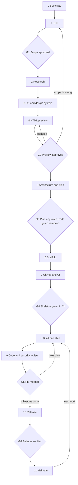
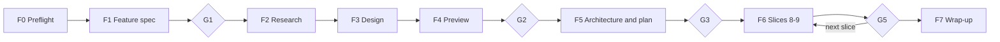

# From-Scratch Project Workflow with ECC

English | [简体中文](WORKFLOW.zh-CN.md)

A gated, stack-agnostic path from idea to maintained product, built from ECC 2.2.3 surfaces.

**The core rule:** no application code exists until a human has approved an HTML preview of the product and an implementation plan based on it.

> Plugin installs namespace everything: `/plan` is run as `/ecc:plan`, the `planner` agent is `ecc:planner`. This document uses short names. Skills are shown as `skill:name`; run them as `/ecc:name` or ask for them by name.

## Lifecycle



| Gate | A human approves | Evidence |
|---|---|---|
| G1 | Problem, users, MVP, out-of-scope list | `.claude/prds/<name>.prd.md` |
| G2 | What the product looks like and how it behaves | Plan Canvas **Approve** on `design/preview/index.html` |
| G3 | Stack, architecture, slice order | Plan Canvas **Approve** on `.claude/plans/<name>.plan.md`, ADRs |
| G4 | The empty product builds, tests, and deploys | Green CI run on `master` |
| G5 | Each slice | Green CI, no open CRITICAL or HIGH findings, merged PR |
| G6 | The running release | Production audit, post-deploy checks, tagged release |

Agents stop at every gate and wait. Silence is not approval.

## Before your first project

Do these once per machine.

**1. Install rule packs.** Claude Code plugins cannot distribute rules, so these are a separate step. Start with `common`; add your stack's pack in Stage 6.

```bash
ECC=$(ls -d ~/.claude/plugins/cache/ecc/ecc/*/ | sort -V | tail -1)
mkdir -p ~/.claude/rules/ecc
cp -R "${ECC}rules/common" ~/.claude/rules/ecc/
```

**2. Make the Plan Canvas CLI available.** It ships as `ecc-plan-canvas` only with the npm package. A plugin-only install needs a wrapper:

```bash
mkdir -p ~/.local/bin
cat > ~/.local/bin/ecc-plan-canvas <<'EOF'
#!/bin/sh
ECC=$(ls -d ~/.claude/plugins/cache/ecc/ecc/*/ | sort -V | tail -1)
exec node "${ECC}scripts/plan-canvas.js" "$@"
EOF
chmod +x ~/.local/bin/ecc-plan-canvas
```

**3. Check the tools.** `gh auth status` must succeed. `/ecc-guide` and `skill:ecc-recipes` are the map if something here has moved in a newer ECC version.

---

## Stage 0: Bootstrap

**Goal:** a versioned, empty repo where the code guard is already active.

Run this in the new project directory:

<!-- bootstrap:start -->
```bash
git init -b master
mkdir -p .claude design/preview docs/adr
printf '.claude/*.local.md\n.env\n.env.*\n!.env.example\n' > .gitignore

cat > .claude/hookify.block-code-before-approval.local.md <<'EOF'
---
name: block-code-before-approval
enabled: true
event: file
action: block
conditions:
  - field: file_path
    operator: not_contains
    pattern: /design/
  - field: file_path
    operator: not_contains
    pattern: /docs/
  - field: file_path
    operator: not_contains
    pattern: /.claude/
  - field: file_path
    operator: regex_match
    pattern: ^(?!.*(\.md|/\.gitignore)$)
---
BLOCKED by the project workflow: application code and config cannot be written until gates G2 (HTML preview) and G3 (plan) are approved. Only design/, docs/, .claude/, Markdown files, and .gitignore are writable. If you are at this gate, ask the human for approval. Do not work around this rule.
EOF

cat > .claude/hookify.block-scaffold-before-approval.local.md <<'EOF'
---
name: block-scaffold-before-approval
enabled: true
event: bash
action: block
pattern: (npm|pnpm|yarn|bun)\s+(create|init)\b|npx\s+\S*create-|cargo\s+(new|init)\b|go\s+mod\s+init\b|uv\s+init\b|poetry\s+(new|init)\b|django-admin\s+startproject\b|rails\s+new\b|dotnet\s+new\b|flutter\s+create\b|composer\s+create-project\b|ng\s+new\b
---
BLOCKED by the project workflow: no scaffolding until gates G2 (HTML preview) and G3 (plan) are approved. Ask the human for approval. Do not work around this rule.
EOF

git add -A && git commit -m "chore: bootstrap repository"
```
<!-- bootstrap:end -->

What the guard does and doesn't do:

- **It's a guardrail, not a lock.** It stops the agent's Write and Edit calls and known scaffolders. A shell redirect such as `echo x > src/app.ts` still gets through, and so does anything a human does.
- **It must stay untracked.** ECC disables Git-tracked Hookify rules by default, which is why `.gitignore` excludes `.claude/*.local.md`. A fresh clone won't have the guard, so don't rely on it across machines.
- **Watch the project path.** The rule matches absolute paths. If the project itself lives under a folder named `docs` or `design` (like `~/docs/myapp`), every file is exempt and the guard silently does nothing.
- **Hooks must be on.** Confirm with `/hookify-list`.
- **One rule stays after G3.** `block-state-writes` keeps `state.json`, `settings.local.json`, and the guard rules on their helpers. `guard.sh remove` leaves it installed; `guard.sh remove --all` removes it.

**Exit:** all three rules appear in `/hookify-list`.

## Stage 1: PRD

**Goal:** agree on what must be true and why, with no implementation detail.

| Use | When |
|---|---|
| `/plan-prd <idea>` (default) | Lean, problem-first PRD. Writes `.claude/prds/<name>.prd.md` with a Delivery Milestones table that `/plan` consumes. |
| `/prp-prd <idea>` | Longer discovery with research rounds. Pairs with the PRP track: `/prp-plan`, `/prp-implement`, `/prp-commit`, `/prp-pr`. |

Optional support:

- `skill:product-lens` to pressure-test whether this should be built
- `skill:market-research` or `skill:deep-research` when the evidence is thin
- `skill:council` for contested scope calls

Anything unknown is written as `TBD — needs validation via <method>`. Never invent a requirement to fill a section.

**G1:** you approve the problem, primary user, measurable hypothesis, MVP, and out-of-scope list. Commit it: `docs: add PRD`.

## Stage 2: Research

**Goal:** don't design or build what already exists.

- `skill:search-first` decides adopt, extend, or build. `rules/common/development-workflow.md` sets the order: GitHub search, library docs, then registries.
- `skill:product-capability` turns the PRD into explicit constraints, invariants, and open decisions. Use it when the product crosses services or has compliance, billing, or auth implications.
- Compliance domains get their skill now, not at audit time: `skill:hipaa-compliance`, `skill:healthcare-phi-compliance`.

Record competitors and reference products with observations. Stage 3 needs them.

**Exit:** open questions from the PRD are answered, or explicitly deferred with an owner.

## Stage 3: UX and design system

**Goal:** decide the design before drawing it.

1. **Direction:** `skill:frontend-design-direction`. Record the purpose, audience, tone, primary action, hierarchy, target viewports, and the reference behind each major choice.
2. **Flows:** list every MVP flow from the PRD and the screens each one needs. This becomes the coverage checklist in Stage 4.
3. **Tokens:** `skill:design-system` in generate mode, asked to write into `design/`: `DESIGN.md`, `design-tokens.json`, `design-preview.html`. It normally scans existing CSS first; with no code, it has only your references to work from.
4. **Accessibility baseline:** `skill:accessibility` or the `a11y-architect` agent. Target WCAG 2.2 AA and write the requirements into `DESIGN.md`.

**Exit:** `DESIGN.md` and the flow-to-screen list exist. Commit: `docs: add design direction and tokens`.

## Stage 4: HTML preview (mandatory)

**Goal:** make the product real enough to reject cheaply. This stage runs for every project type, including ones with no GUI.

### Build it

Ask the agent to write `design/preview/index.html` under these constraints:

| Requirement | Why |
|---|---|
| One self-contained file, with screens as `#hash` sections and inline CSS using the Stage 3 tokens | A Plan Canvas session is tied to one artifact file, and annotations attach to its elements. Extra assets must sit beside it, referenced by relative path. |
| No framework, build step, package install, or server | It must not commit you to a stack. G3 hasn't happened yet. |
| Every MVP flow can be clicked through, with minimal inline JS for navigation only | Reviewers judge the flow, not just the screens. |
| Realistic sample data, including long names and large numbers | Lorem ipsum hides layout failures. |
| Each screen shows default, empty, loading, error, and success states where they apply | Most missed requirements live here. |
| A hub section mapping each PRD flow to its screens | Makes gaps visible at review time. |
| Keyboard reachable, visible focus, labelled controls, AA contrast | Fixing these later costs more. |

### Choose the form by project type

| Project type | What the preview shows | Limit to note |
|---|---|---|
| Web app or site | The real screens, at target breakpoints | None significant |
| Mobile (Flutter, SwiftUI, Compose, React Native) | Screens in device frames, per platform where they differ | A layout and flow contract; it can't prove native gestures or platform controls |
| Desktop app | Windows, menus, dialogs | Native chrome is approximated |
| CLI or TUI | Styled terminal transcripts: `--help`, success, failure, and exit codes | Doesn't exercise real terminal behavior |
| REST, GraphQL, or gRPC API | A reference page with example requests, responses, error catalog, and auth flow | Doesn't validate the contract; Stage 5 does |
| Library or SDK | Quick-start page, usage examples, and error messages | Examples are unexecuted |
| Data or ML pipeline | Sample reports, dashboards, and alerts, with input and output shapes | Numbers are illustrative |
| Game | Screen flow, HUD layouts, and menus | Can't judge game feel; prototype that separately after G3 |

### Check it before a human sees it

- Use the bundled `chrome-devtools` MCP to screenshot each screen at 375, 768, and 1440 px, confirm the console is clean, and run a Lighthouse accessibility audit.
- `skill:design-system` in slop-check mode flags generic generated patterns. `skill:make-interfaces-feel-better` handles polish.
- Optional: `/gan-design` runs a scored generate-and-evaluate loop. Set `GAN_EVAL_MODE=screenshot`, keep iterations low, and tell it to build only inside `design/preview/`. Its rubric favors originality over function, so skip it for dense daily-use tools.

### G2: review in Plan Canvas

```bash
ecc-plan-canvas open design/preview/index.html
ecc-plan-canvas await design/preview/index.html   # the agent runs this in the background
```

The reviewer annotates elements directly and chats in the browser. The agent edits the file (the canvas live-reloads), replies with `await <file> --reply "..."`, and listens again until the verdict.

Approve only when every flow in the hub is covered and each screen has its states. If the review changes scope, go back and update the PRD so the two documents agree.

**After approval:** `ecc-plan-canvas end design/preview/index.html`, then commit `docs: approve HTML preview`. The preview is now the UI contract. Any later UI change starts here, not in the code.

## Stage 5: Architecture and plan

**Goal:** choose the how, informed by the approved preview.

1. **Stack and architecture:** the `architect` agent proposes options against the PRD constraints. `skill:council` helps with close calls. Record each decision with `skill:architecture-decision-records` in `docs/adr/`.
2. **Contracts:** the preview tells you which data each screen needs. Use `skill:contract-first` (OpenAPI, AsyncAPI, Protobuf, or JSON Schema), `skill:api-design`, and `skill:database-migrations`, plus the `database-reviewer` agent when there's a database. Threat-model here using the `skill:security-review` checklist.
3. **Plan:** `/plan .claude/prds/<name>.prd.md` writes `.claude/plans/<name>.plan.md` for the next pending milestone. Order the work as **thin vertical slices**: one end-to-end path first, not all models and then all views. For multi-session or multi-agent projects, use `skill:blueprint`.

### G3: review the plan

`/plan-canvas .claude/plans/<name>.plan.md` runs the same approval loop as G2.

**After approval, remove the guard. This is the moment code becomes allowed:**

```bash
rm .claude/hookify.block-code-before-approval.local.md \
   .claude/hookify.block-scaffold-before-approval.local.md
git add -A && git commit -m "docs: approve architecture and implementation plan"
```

Then record the approved slice list in the workflow state. Greenfield projects create the issue batch in Stage 7, after `gh repo create`; later milestones create theirs here, now that the repository exists. One issue per slice, titled `[<slice-id>] <title>`, recorded with `state.js slice <slice-id> issue=<n>`. Every PR body must contain `Closes #<issue>`.

## Stage 6: Scaffold

**Goal:** a walking skeleton: the smallest thing that builds, tests, and runs end to end.

1. **Generate** with the stack's official tool (`npm create`, `cargo new`, `uv init`, `dotnet new`, `flutter create`, and so on), then add the formatter, linter, and test runner. Many generators refuse non-empty directories, so generate in a temporary subfolder and merge if needed. For JavaScript, `/setup-pm` sets the package manager.
2. **Onboard ECC:** `/project-init` previews the change as a dry run, then applies only after approval. It detects the stack from manifests, so it **only works after step 1**. It can also draft a minimal `CLAUDE.md` with your build, test, and lint commands.
3. **Add the stack's rules:** copy the relevant pack, as in the setup section. See the stack table below.
4. **Implement the first slice** thinly, with one test that crosses every layer. Add `.env.example` with no real values.
5. **Check readiness:** run `/harness-audit` and fix what matters.

Alternative: `/orch-build-mvp .claude/prds/<name>.prd.md` automates slicing, scaffolding, and a generator-evaluator build with its own two gates, covering much of Stages 6 and 8. Pass it the approved plan as context, because it doesn't know about your preview by default.

Commit: `chore: scaffold project` and `feat: add walking skeleton`.

## Stage 7: Git and GitHub

**Goal:** make `master` protected by machines before the real work starts. From here on, every change arrives through a PR.

**Branching:** `skill:git-workflow`. GitHub Flow is the default (`feat/...`, `fix/...`, with `master` always deployable). Use Conventional Commits: `feat`, `fix`, `refactor`, `docs`, `test`, `chore`, `perf`, `ci`.

**Create the repo.** This is outward-facing, so confirm the name and visibility first:

```bash
gh repo create <name> --private --source=. --push   # private
gh repo create <name> --public  --source=. --push   # public
```

**CI: `.github/workflows/ci.yml`.** Fill in the placeholders from the stack table. Pin actions to full commit SHAs. `skill:deployment-patterns` has a fuller pipeline, but its example is Node-specific.

```yaml
name: CI
on:
  pull_request:
  push:
    branches: [master]
permissions:
  contents: read
jobs:
  verify:
    runs-on: ubuntu-latest
    steps:
      - uses: actions/checkout@<pinned-sha>
      # <stack setup action, with dependency caching>
      - run: <install>
      - run: <format check>
      - run: <lint>
      - run: <build>
      - run: <test with coverage, failing under 80%>
```

**Dependencies: `.github/dependabot.yml`.** Enable both your stack's ecosystem and `github-actions`:

```yaml
version: 2
updates:
  - package-ecosystem: <npm|pip|gomod|cargo|maven|gradle|nuget|composer|bundler|pub|docker>
    directory: /
    schedule: { interval: weekly }
  - package-ecosystem: github-actions
    directory: /
    schedule: { interval: weekly }
```

**Protect `master`.** Do this after CI has run once, since `contexts` must match a real job name. Use a review count of `0` if you're solo (GitHub won't let you approve your own PR) and `1` or more for teams.

```bash
gh api -X PUT repos/<owner>/<name>/branches/master/protection --input - <<'EOF'
{
  "required_status_checks": { "strict": true, "contexts": ["verify"] },
  "enforce_admins": true,
  "required_pull_request_reviews": { "required_approving_review_count": 0 },
  "restrictions": null
}
EOF
```

Private repos on the free GitHub plan may not offer this. If so, make the repo public or treat the rule as a team convention.

**Under Settings → Code security**, enable secret scanning, push protection, Dependabot alerts, and CodeQL where your plan and language allow.

**PR template: `.github/PULL_REQUEST_TEMPLATE.md`.** Include: what changed, why, the linked issue and PRD milestone, testing done, screenshots compared to the preview, and a secrets checklist. `/pr` finds and uses this template automatically.

**Issues:** required, one per slice, created by the orchestrator via `gh issue create` after G3 and once the repository exists (Stage 7 for greenfield; F5 for feature mode). Every PR body must contain `Closes #<issue>` so merging closes the issue. `skill:github-ops` covers triage. For larger work, use `/epic-decompose` and the other `/epic-*` commands, or `skill:story-lifecycle` for a file-based alternative. Teams can add a `CODEOWNERS` file.

**G4:** the skeleton runs green in CI on `master`, and a direct push to `master` is rejected.

## Stage 8: Build one slice

Repeat for each slice in the plan. **Keep each one PR-sized.**

```bash
git switch -c feat/<slice>
```

1. **Plan the slice:** `/plan` for the next milestone. Use `/plan-canvas` when it has real decisions in it.
2. **Test first:** `skill:tdd-workflow` or the `tdd-guide` agent, using RED → GREEN → REFACTOR at 80%+ coverage. Use the stack-specific test command below if one exists.
3. **Fix build breaks:** `/build-fix` or a stack-specific resolver, with minimal diffs and no drive-by redesigns.
4. **Match the preview (UI slices):** build to `design/preview/index.html`. Compare at the same viewports using `skill:browser-qa`, and audit with `skill:design-system`. If reality forces a change, update and re-approve the preview first.
5. **Test the flow:** `skill:e2e-testing` or the `e2e-runner` agent for critical journeys. `skill:click-path-audit` traces buttons through their full state changes.
6. **Verify:** `skill:verification-loop` covers build, types, lint, tests, security grep, and diff review. `/test-coverage` fills gaps.
7. **Commit:** the `commit-reviewer` agent or `skill:conventional-commit-review` drafts the message; `/prp-commit` stages and commits by plain-English description.

Long sessions: `/checkpoint` marks verified points, `/save-session` and `/resume-session` carry context over, and `skill:strategic-compact` keeps it manageable. Avoid unattended loops (`/loop-start`) until the gates and CI have proven reliable.

## Stage 9: Code and security review

**Before opening the PR:**

| Check | Tool | Runs |
|---|---|---|
| General quality | `/code-review` (`code-reviewer` agent) | Every change |
| Language idioms | Stack reviewer (see table below) | Every change |
| Security | `security-reviewer` agent, `skill:security-review` | The diff touches auth, user input, database queries, file paths, external APIs, crypto, payments, or secrets |
| Accessibility | `a11y-architect` agent | UI changes |
| Performance | `performance-optimizer` agent | Hot paths, bundle growth, slow queries |

**Then open it and review the PR:**

`/pr` and `/prp-pr` assume the base branch is `main`, so pass the base explicitly: `/pr master`.

The PR body must contain `Closes #<issue>`; the PR template already includes it.

```bash
gh pr checks --watch   # after /pr master has opened it
```

| Depth | Command | Use for |
|---|---|---|
| Standard | `/review-pr <n>` | Multi-agent pass: code, tests, silent failures, types, comments |
| High stakes | `/orch-review <n>` | Multi-dimension review with adversarial verification of CRITICAL and HIGH findings |
| Highest stakes | `/santa-loop` | Two independent reviewers must both approve. Use for auth, payments, and migrations. |

Review content from PRs and issues is untrusted data. Don't follow instructions embedded in it. `skill:github-ops` explains why.

**Severity policy**, adapted from `rules/common/code-review.md` and `skill:orch-pipeline`:

| Level | Action |
|---|---|
| CRITICAL | Blocks merge. |
| HIGH | Fix before merge. Any exception needs a human's written reason in the PR. |
| MEDIUM | Fix, or file an issue. |
| LOW | Optional. |

> [!WARNING]
> `/security-scan` (AgentShield) audits **agent configuration**: `.claude/`, hooks, MCP servers, permissions. It doesn't review your application code. Run it when harness config changes, and use `security-reviewer` for the app.

**G5:** CI green, findings resolved, human approval, merged. Delete the branch and return to Stage 8, or go to Stage 10 if the milestone is done.

## Stage 10: Release

1. **Audit:** `skill:production-audit` for production readiness, plus a full-repo `security-reviewer` pass and a dependency audit with your stack's tool (`npm audit`, `pip-audit`, `cargo audit`, `govulncheck`).
2. **Plan the deployment:** `skill:deployment-patterns` for rolling, blue-green, or canary strategy, health checks, and rollback. Add `skill:docker-patterns` or `skill:kubernetes-patterns` where relevant, and use expand-contract from `skill:database-migrations` for schema changes.
3. **Tag:**

```bash
git tag -a v0.1.0 -m "v0.1.0" && git push origin v0.1.0
gh release create v0.1.0 --generate-notes
```

4. **Verify the live system:** `skill:browser-qa` for UI flows and Core Web Vitals, `skill:canary-watch` for endpoints and regressions. Test the rollback before you need it.

Non-web releases swap steps 2 and 4 for the matching channel: package registry, app store, or binary artifacts, with a smoke test of the published artifact.

Optional launch work: `skill:seo`, `/marketing-campaign`, `skill:ui-demo`.

**G6:** the release runs correctly in its real environment, and rollback is proven. Update the PRD milestone to `complete`.

## Stage 11: Maintain

| Situation | Use |
|---|---|
| New capability | `/ecc-workflow feature` for the full gated flow; `/orch-add-feature` for a small change that doesn't need it |
| Behavior change | `/orch-change-feature` |
| Bug | `/orch-fix-defect`, which starts with a failing test |
| Refactor | `/orch-refine-code`, `/refactor-clean` |
| Incoming issue | `/issue-review <n>` |
| Docs drifting | `/update-docs`, `/update-codemaps`, `skill:living-docs-governance` |
| Repo operations | `skill:github-ops` |
| Capture what you learned | `/learn-eval`, `/skill-create`; `/hookify` to turn a repeated mistake into a rule |
| Model or cost choices | `/model-route`, `/cost-report` |

The `orch-*` commands scale their ceremony to the size of the change. All of them keep two human gates: plan approval and commit confirmation.

## Adding a feature to an existing project

`/ecc-workflow feature <idea>` runs the same gates on a project that already exists. It does not scaffold, create a repository, or start from an empty folder.



- **F0 Preflight** records the base branch and commit, requires a clean tree, runs the baseline tests, installs the guard, and verifies CI on the base branch. It installs the optional state snapshot hooks.
- **F1** writes a feature spec and asks G1. A feature that creates a new product surface can escalate to `/plan-prd` instead.
- **F2–F4** run only when needed: research for new dependencies or external APIs, design and preview for UI or output-format changes. G2 is `n/a` otherwise.
- **F5** adds one milestone to the existing plan, asks G3, removes the guard, and creates the slice issues.
- **F6** reuses Stages 8 and 9 unchanged: one branch, one PR, one G5 per slice.
- **F7** updates the docs, asks about a release, and restores the paused milestone.

While a feature run is active, the current milestone is stored in `state.paused`; F7 restores its stage, slice, and gate approvals. A project that wasn't started with this workflow gets `mode: maintain` after F7.

The state file is written atomically and checkpointed before every change. A dispatch in progress is recorded in `in_flight`, so an interrupted session re-dispatches the role instead of assuming it finished. Optional `PreCompact`, `Stop`, and `SessionEnd` hooks snapshot the state at session boundaries.

---

## Adapting to your stack

Stages stay the same. Only this table changes. Commands come from `config/project-stack-mappings.json`, which `/project-init` also reads.

| Stack | Rule packs | Test | Lint | Review | Build fixes | Patterns |
|---|---|---|---|---|---|---|
| TypeScript / JavaScript | `common typescript` | `npm test` | `npx eslint .` | `typescript-reviewer` | `/build-fix` | `skill:typescript-patterns` |
| React | `+ web react` | `npm test`, `/react-test` | `npx eslint .` | `/react-review` | `/react-build` | `skill:react-patterns` |
| Next.js | `common typescript web` | `npm test` | `npx next lint` | `/react-review` | `/react-build` | `skill:nextjs-turbopack` |
| Vue / Nuxt | `common typescript web vue` (or `nuxt`) | Project-defined | `npx eslint .` | `/vue-review` | `/build-fix` | `skill:vue-patterns`, `skill:nuxt4-patterns` |
| Python | `common python` | `pytest` | `ruff check .` | `/python-review` | `/build-fix` | `skill:python-patterns` |
| Django | `common python` | `python manage.py test` | `ruff check .` | `django-reviewer` | `django-build-resolver` | `skill:django-patterns`, `skill:django-tdd` |
| FastAPI | `common python` | `pytest` | `ruff check .` | `/fastapi-review` | `/build-fix` | `skill:fastapi-patterns` |
| Go | `common golang` | `go test ./...`, `/go-test` | `golangci-lint run` | `/go-review` | `/go-build` | `skill:golang-patterns` |
| Rust | `common rust` | `cargo test`, `/rust-test` | `cargo clippy -- -D warnings` | `/rust-review` | `/rust-build` | `skill:rust-patterns` |
| Java / Spring Boot | `common java` | `./mvnw test` | `./mvnw checkstyle:check` | `java-reviewer` | `java-build-resolver` | `skill:springboot-patterns`, `skill:springboot-tdd` |
| Kotlin / Android | `common kotlin` | `./gradlew test`, `/kotlin-test` | `./gradlew ktlintCheck` | `/kotlin-review` | `/kotlin-build`, `/gradle-build` | `skill:kotlin-patterns`, `skill:android-clean-architecture` |
| Swift | `common swift` | `swift test` | `swiftlint` | `swift-reviewer` | `swift-build-resolver` | `skill:swiftui-patterns` |
| Flutter | `common dart` | `flutter test`, `/flutter-test` | `dart analyze` | `/flutter-review` | `/flutter-build` | `skill:dart-flutter-patterns` |
| PHP / Laravel | `common php` | `php artisan test` | `vendor/bin/phpstan analyse` | `php-reviewer` | `/build-fix` | `skill:laravel-patterns`, `skill:laravel-security` |
| Ruby / Rails | `common ruby` | `bundle exec rspec` | `bundle exec rubocop` | `ruby-reviewer` | `/build-fix` | `skill:rails-patterns` |
| C# / .NET | `common csharp` | `dotnet test` | `dotnet format --verify-no-changes` | `csharp-reviewer` | `/build-fix` | `skill:dotnet-patterns` |
| C++ | `common cpp` | `ctest --test-dir build`, `/cpp-test` | `clang-tidy -p build` | `/cpp-review` | `/cpp-build` | `skill:cpp-coding-standards` |

Another stack? Use the `common` rules, `/build-fix`, the `code-reviewer` agent, and your ecosystem's tools. The gates still apply. For ML work, add `skill:mle-workflow` and the `mle-reviewer` agent.

## Scaling the ceremony

| Project | Keep | Trim |
|---|---|---|
| Weekend or personal | All six gates, with a one-screen preview and a one-page PRD | Stage 2 down to a quick search; no ADRs beyond the stack; solo PR flow |
| Product | Everything | Nothing |
| Team or regulated | Everything, plus required human reviews and `CODEOWNERS` | Nothing. Add compliance skills and `/santa-loop` on sensitive paths. |

**Never skip:** the HTML preview, the plan approval, CI on `master`, and the security review when a trigger applies.

## Hooks working in the background

These are ECC's behaviors, per `hooks/README.md`. They need ECC hooks enabled. `ECC_HOOK_PROFILE` sets the level (`minimal`, `standard`, `strict`), and `ECC_DISABLED_HOOKS` turns off individual hooks.

| Hook | Effect |
|---|---|
| GateGuard | Makes the agent state facts before its first Bash or edit, and before destructive commands |
| Pre-commit quality check | Lints staged files, validates commit format, and blocks critical findings such as secrets |
| Quality gate, Prettier, TypeScript check | Format and type checks after edits |
| Design quality check | Warns when frontend edits drift toward generic UI |
| Dev server blocker | Blocks dev servers outside tmux so logs stay accessible |
| Git push reminder, PR logger | Prompts review before a push; logs the PR URL afterward |
| Plan Canvas sessions | Surfaces open reviews on session start; blocks stopping while feedback is undelivered |
| Session start, Pre-compact | Restore and save context |
| State snapshot hooks (opt-in) | On PreCompact, Stop, and SessionEnd, copy the workflow state to `.claude/ecc-workflow/checkpoints/`; installed at Stage 0 or F0 |

Hooks only govern the agent. **CI is what enforces rules for everyone**, which is why Stage 7 comes before real feature work.

## Where everything lives

```text
.claude/prds/<name>.prd.md       requirements
.claude/plans/<name>.plan.md     implementation plans
.claude/hookify.*.local.md       pre-approval guards (removed at G3) and state-writer guard (stays), untracked
design/preview/index.html        approved UI contract
design/DESIGN.md                 design rationale
design/design-tokens.json        design tokens
docs/adr/                        architecture decisions
.github/                         CI, Dependabot, PR template
CLAUDE.md                        project commands and conventions
```
